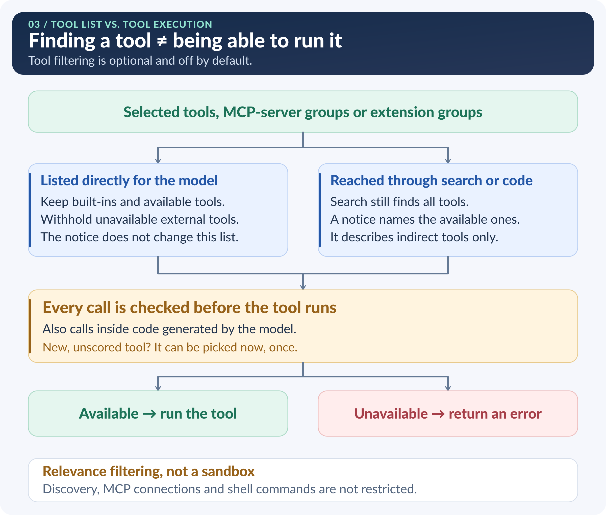

# pi-context-decisions

Give [Pi](https://pi.dev) the skills relevant to your task, without advertising your entire collection up front.

This extension uses a decision model to pick skill descriptions for Pi to see. As your task changes, it can add more. Skills already advertised stay available for the rest of that session branch.

It can also filter external tools, MCP servers and extension tool groups. That is a separate feature, **off by default**.

## When is it useful?

- **You have lots of skills.** For a task such as “Review these validation changes,” it can advertise relevant review skills instead of unrelated release or UI skills.
- **Your work changes during a session.** Move from reviewing code to preparing a release, and relevant release skills can be added without dropping the earlier ones.
- **You have many tools or MCP servers.** Enable tool filtering to make relevant external tools available as needed, while keeping essentials always allowed.

If you only have a few skills, you may not need it: by default, fewer than eight automatic skills are left unfiltered. Decision calls add latency and may incur provider charges.

## Install and set up

Requires **Node 22.18+** and **Pi 1.1.0 APIs**.

```bash
pi install npm:pi-context-decisions
```

Keep this package first or near the start of your configured extensions. In Pi:

1. Run `/decisions`.
2. Open **Advanced**, choose **Provider / execution**, then **Model**. Supported backends are Pi classifiers, TypeSafe, OpenAI and OpenRouter.
3. If credentials are missing, configure the matching `TYPESAFE_API_KEY`, `OPENAI_API_KEY` or `OPENROUTER_API_KEY`, or use Pi's `/login <provider>`. OpenAI needs an API key, not Codex/ChatGPT OAuth.
4. In **Skills**, leave **Skill filtering** on. Optionally choose skills under **Always allowed · Global** or **Always allowed · Project**; save allowlist edits with **Ctrl+S**.
5. Close the dialog and start a fresh session before sending your first task.

**No decision model is selected by default.** Until you select one, nothing is filtered and no decision calls are made. Selecting a model does not change either filtering switch. A fresh session matters because filtering never retracts skills or tools already made available on a branch.

Use **Tab** to switch settings tabs, **Enter** to select, **Space** to toggle, and **Esc** to go back or close.

## Use it

Ask Pi to work normally, for example:

```text
Review these validation changes for missing edge cases.
```

The picker scores unadvertised skills and adds relevant ones. By default it runs on each prompt and adds up to 12 new skills per round. It advertises names, descriptions and locations—not full skill bodies.

Use `/decisions history` to see committed additions on this branch, or `/decisions status` to check setup and the last decision:

```text
/decisions history
/decisions status
```

To try tool filtering, open `/decisions` → **Tools**, enable **Tool filtering**, and choose a mode:

- **tools:** pick individual external tools.
- **mcp:** pick whole MCP-server or extension tool groups.

Add essentials to the Tools tab's always-allowed lists, then start a fresh session. `/decisions tools list` and `/decisions mcp list` show availability without making decision calls.

## Inside the agent loop

Think of the decider as a **context picker beside your coding agent**, not another agent doing the task. The coding model chooses actions; the decision model only ranks which skills and tools are relevant. Purple boxes below show context selection.

### 1. The familiar loop, with a picker added


The usual loop is unchanged: **task → model → tool → result → model → answer**. Selection happens before the first coding-model step and, when needed, between later steps. The picker never forces an extra coding-model turn. Tool filtering is optional; when enabled, it also checks calls before execution.

### 2. Keep earlier choices; add relevant ones


A **skill** is reusable guidance the coding model can load; the picker advertises its description, not its full instructions. Tools can be picked individually, or as whole **MCP-server or extension tool groups**.

For example: “Review this code” might add a review skill. Later, “Prepare a release” can add a release skill **without removing the review skill**. Choices only grow along the current conversation branch. Your always-allowed items skip scoring.

### 3. Finding a tool does not mean it can run



**Direct tools** have their definitions listed in the model request. **Indirect tools** are reached through search or generated code (codemode). A short notice tells the model which indirect tools are available; it does not override the direct list. Both direct and nested calls are checked before the target tool runs. Discovery and MCP connections stay unchanged—this is relevance filtering, **not a sandbox**.

### When does it pick again?

Choose the timing (called *cadence*) separately for skills and tools:

| Setting | In plain English |
| --- | --- |
| **Each prompt** (`prompt`, default) | Pick for each new user task, including an update you queue while the agent is working. |
| **After tool rounds too** (`tool-round`) | Also add more after completed tool results, before the next model step. Reuse scores for the same user task—not guesses about a new subtask. |
| **First prompt only** (`initial`, tools only) | Keep using the first task. Later tools are checked against it; candidates already considered are not picked again. A failed first pick can retry. |

New tools can also be checked when they appear or are first called. With no decision model selected, or too few candidates, everything stays available without scoring. A failed decision adds nothing by default; earlier choices stay.

<details>
<summary>Pi hook names and timing details (optional)</summary>

- **Before a run:** `before_agent_start` runs before Pi saves the submitted user message. Skill and tool selection overlap here.
- **Between steps:** `turn_end` adds context only after a completed turn when `context.canContinue` is true. The assistant and tool results are already saved; Pi saves additions before inserting queued user text. The loop then returns to the next model request, not to `before_agent_start`. This extension never sets `continue`.
- **What the coding model sees:** always-allowed/base skills in the system skills section; new skills (with file locations) in hidden **user-role** custom messages; active tool declarations; and a separate names-only notice for indirect tools. Bookkeeping records are not model context. Skills need an active `read` or `bash` tool to be advertised.
- **At execution:** `tool_call` checks direct and nested calls. Eligible unscored tools can trigger one shared decision round. MCP resource calls are routed by their local `server` argument; unscoped resource listing is blocked while filtering is on. No call arguments reach the decision model.
- **Limits:** late-connecting direct tools can appear in the first request, but calls are still checked. Enabling mid-session preserves registered tools. Compaction can temporarily hide skill additions until they are re-delivered without scoring; tool notices are not re-delivered.

See [skill picking](docs/skill-picking.md) and [tool-filtering limitations](docs/tool-filtering.md#limits-stated-plainly) for the full contracts.

</details>

Editable SVGs: [agent loop](docs/assets/agent-session-loop.svg) · [picker](docs/assets/context-decider.svg) · [tool checks](docs/assets/tool-availability-gates.svg). [Offline PNG regeneration and implementation notes](docs/assets/README.md).

## Know before enabling

- **Metadata leaves Pi.** The selected decision provider receives bounded user-task text and skill names/descriptions. Tool filtering also sends tool/group metadata. It does not send skill bodies, tool arguments/results or conversation transcripts.
- **Additions are permanent on that branch.** Removing an always-allowed entry does not retract an earlier addition. A failed decision adds nothing by default; existing additions stay.
- **This is not a sandbox.** Skill filtering changes advertisements, not permissions. Tool filtering gates Pi tool calls, but does not stop server connections, hide discovery results or restrict `bash` and other processes.

## Documentation

- [Settings, commands and always-allowed lists](docs/settings.md)
- [Providers and credentials](docs/providers.md)
- [How skill picking works](docs/skill-picking.md)
- [Tool/MCP filtering and its limitations](docs/tool-filtering.md)
- [Library API](docs/api.md)
- [Development and tests](docs/development.md) · [Publishing](docs/publishing.md)
- [Changelog](CHANGELOG.md)

[MIT license](LICENSE).
