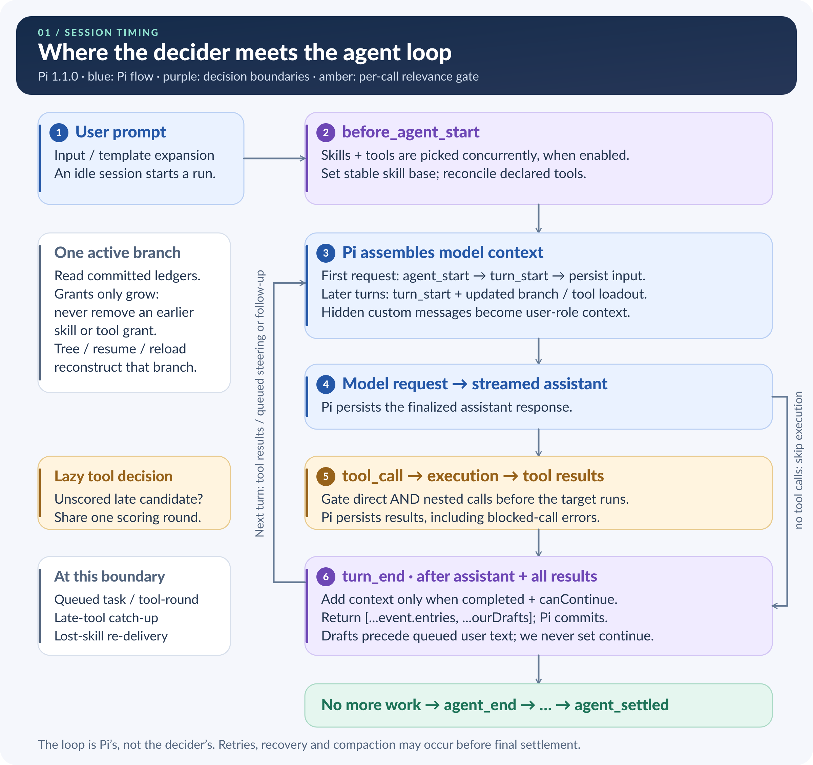
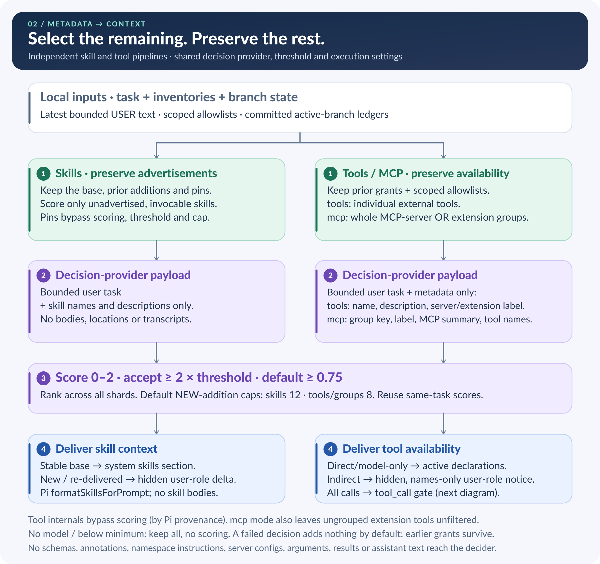

# pi-context-decisions

Give [Pi](https://pi.dev) the skills relevant to your task, without advertising your entire collection up front.

This extension uses a decision model to pick skill descriptions for Pi to see. As your task changes, it can add more. Skills already advertised stay available for the rest of that session branch.

It can also filter external tools, MCP servers and extension tool groups. That is a separate feature, **off by default**.

## When is it useful?

- **You have lots of skills.** For a task such as “Review these validation changes,” it can advertise relevant review skills instead of unrelated release or UI skills.
- **Your work changes during a session.** Move from reviewing code to preparing a release, and relevant release skills can be added without dropping the earlier ones.
- **You have many tools or MCP servers.** Enable tool filtering to make relevant external tools available as needed, while keeping essentials always allowed.

If you only have a few skills, you may not need it: by default, fewer than eight automatic skills are left unfiltered. Decision calls add latency and may incur provider charges.

## Install and set up

Requires **Node 22.18+** and **Pi 1.1.0 APIs**.

```bash
pi install npm:pi-context-decisions
```

Keep this package first or near the start of your configured extensions. In Pi:

1. Run `/decisions`.
2. Open **Advanced**, choose **Provider / execution**, then **Model**. Supported backends are Pi classifiers, TypeSafe, OpenAI and OpenRouter.
3. If credentials are missing, configure the matching `TYPESAFE_API_KEY`, `OPENAI_API_KEY` or `OPENROUTER_API_KEY`, or use Pi's `/login <provider>`. OpenAI needs an API key, not Codex/ChatGPT OAuth.
4. In **Skills**, leave **Skill filtering** on. Optionally choose skills under **Always allowed · Global** or **Always allowed · Project**; save allowlist edits with **Ctrl+S**.
5. Close the dialog and start a fresh session before sending your first task.

**No decision model is selected by default.** Until you select one, nothing is filtered and no decision calls are made. Selecting a model does not change either filtering switch. A fresh session matters because filtering never retracts skills or tools already made available on a branch.

Use **Tab** to switch settings tabs, **Enter** to select, **Space** to toggle, and **Esc** to go back or close.

## Use it

Ask Pi to work normally, for example:

```text
Review these validation changes for missing edge cases.
```

The picker scores unadvertised skills and adds relevant ones. By default it runs on each prompt and adds up to 12 new skills per round. It advertises names, descriptions and locations—not full skill bodies.

Use `/decisions history` to see committed additions on this branch, or `/decisions status` to check setup and the last decision:

```text
/decisions history
/decisions status
```

To try tool filtering, open `/decisions` → **Tools**, enable **Tool filtering**, and choose a mode:

- **tools:** pick individual external tools.
- **mcp:** pick whole MCP-server or extension tool groups.

Add essentials to the Tools tab's always-allowed lists, then start a fresh session. `/decisions tools list` and `/decisions mcp list` show availability without making decision calls.

## Inside the agent loop

### 1. The two context-selection boundaries



`before_agent_start` runs **before Pi commits the submitted user message**. The skill and tool passes overlap there. At `turn_end`, the assistant and all tool results are already persisted; this extension only adds context when the turn completed and `context.canContinue` is true. It preserves earlier handlers' drafts with `[...event.entries, ...ourDrafts]`; Pi commits those drafts before injecting queued user text. The loop returns to the next request, **not** to `before_agent_start`. The extension never sets `continue` or creates an extra model request.

### 2. What the decider selects—and what reaches the chat model



The decision provider sees bounded user-task text and candidate metadata, **not** conversation history or tool results. The chat model sees a stable system skills base, new skills as hidden **user-role** custom messages (including their canonical locations), and Pi's active tool declarations. Indirect tools get a separate names-only hidden user-role availability notice. Base/tool ledger records are **not** model context; skill grants come from the deltas Pi actually committed on the active branch.

| Cadence | When selection runs |
| --- | --- |
| `prompt` (default, both pipelines) | Each submitted user prompt, plus newest queued steering/follow-up user text at a completed, continuing `turn_end`. |
| `tool-round` (both pipelines) | Prompt behavior **plus** completed tool rounds. Progressively add next-best remaining candidates for the same user task, reusing cached scores—not inferred subtasks. |
| `initial` (tools only) | First user prompt after filtering becomes active. Later arrivals use that first task; persisted `considered` candidates are not re-picked. A failed initial pick retries on a later prompt. |

Tools also catch up with unscored late arrivals at continuing boundaries, or lazily at `tool_call` in one shared scoring round. With no decision model or below the inventory minimum, selection makes no calls and keeps everything available. Disabled pipelines do not score. Active decision/configuration errors add nothing by default; earlier grants survive. Skills require an active `read` or `bash` reader to be advertised.

### 3. Tool declarations are not the indirect-call gate


The notice applies **only to indirect tools** reached through codemode/tool search; it does not override tools declared directly. The runtime `tool_call` gate still checks direct and nested external calls. Discovery (`searchTools`, `ALL_TOOLS`, `tool_search`, the `mcp_servers` prompt section) and MCP connections are unchanged. This is relevance gating, **not a sandbox**.

Important timing limits: a direct tool connecting after the initial hook can appear in the first request (its calls are still gated); enabling mid-session preserves already-registered tools. Compaction can hide a skill delta until the next eligible boundary re-delivers it without scoring; the request immediately after mid-run compaction can miss it. Tool notices are not re-delivered after compaction. See [skill picking](docs/skill-picking.md) and [tool-filtering limitations](docs/tool-filtering.md#limits-stated-plainly) for the full contracts.

Editable SVGs: [session loop](docs/assets/agent-session-loop.svg) · [decider](docs/assets/context-decider.svg) · [tool gates](docs/assets/tool-availability-gates.svg). [Offline PNG regeneration and implementation anchors](docs/assets/README.md).

## Know before enabling

- **Metadata leaves Pi.** The selected decision provider receives bounded user-task text and skill names/descriptions. Tool filtering also sends tool/group metadata. It does not send skill bodies, tool arguments/results or conversation transcripts.
- **Additions are permanent on that branch.** Removing an always-allowed entry does not retract an earlier addition. A failed decision adds nothing by default; existing additions stay.
- **This is not a sandbox.** Skill filtering changes advertisements, not permissions. Tool filtering gates Pi tool calls, but does not stop server connections, hide discovery results or restrict `bash` and other processes.

## Documentation

- [Settings, commands and always-allowed lists](docs/settings.md)
- [Providers and credentials](docs/providers.md)
- [How skill picking works](docs/skill-picking.md)
- [Tool/MCP filtering and its limitations](docs/tool-filtering.md)
- [Library API](docs/api.md)
- [Development and tests](docs/development.md) · [Publishing](docs/publishing.md)
- [Changelog](CHANGELOG.md)

[MIT license](LICENSE).
