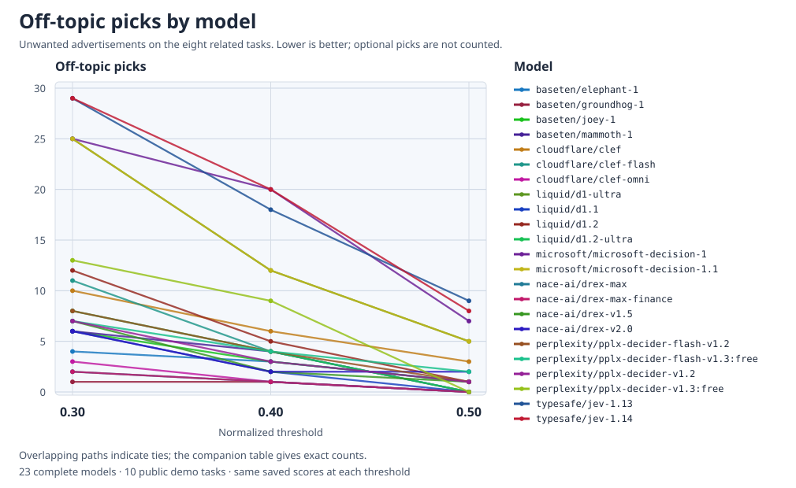
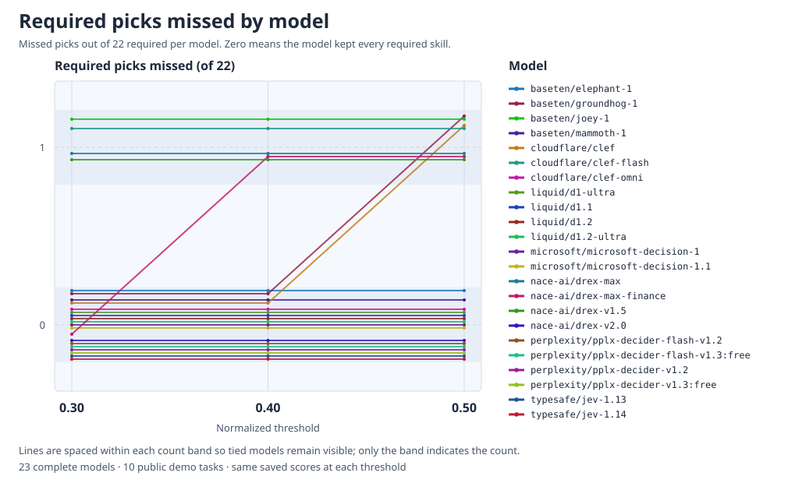
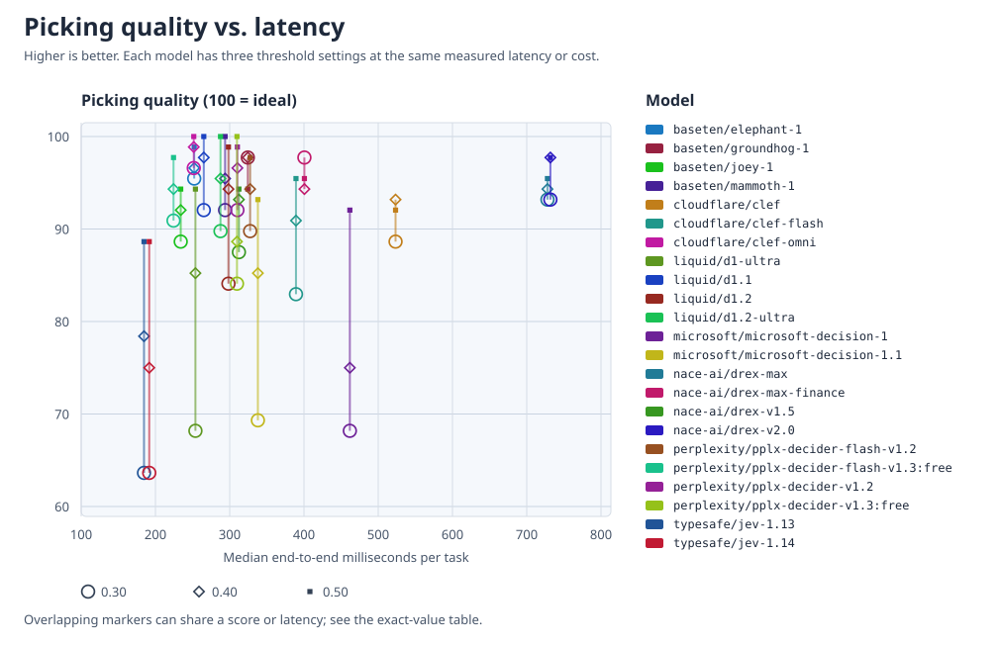
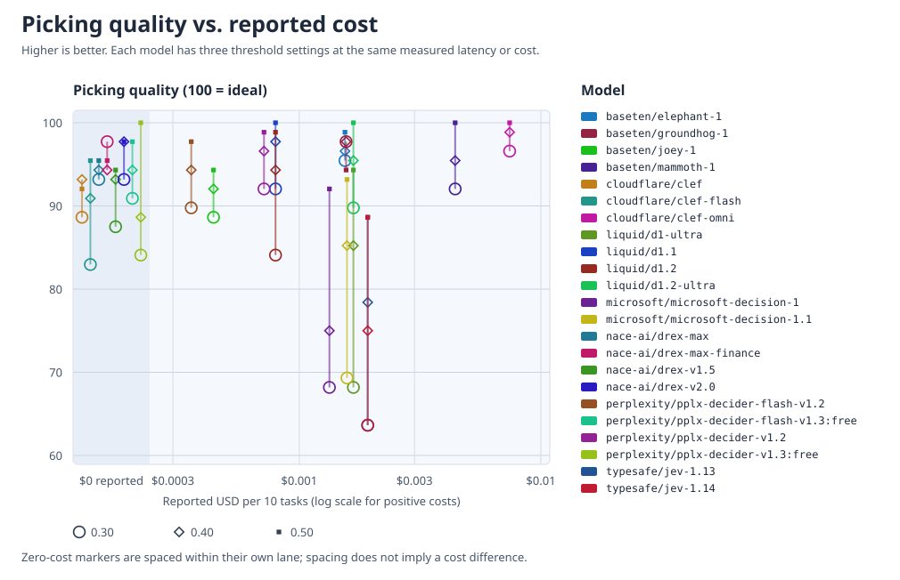

# What changes at decision thresholds 0.30, 0.40, and 0.50?

This is an offline replay of the [November 22 benchmark](decision-models-2026-11-22.md), using the same saved scores and [manual allow/deny labels](decision-model-baseline.json). It covers the **23 models that completed all ten tasks**. Every threshold uses the production cap of 12 picks per task and the same inclusive score cutoff (`raw score ≥ 2 × threshold`). No new inference was needed.

## The trade-off

| Threshold | Required picks kept | Required picks missed | Off-topic picks on related tasks | Picks on unrelated controls | Optional picks kept |
| ---: | ---: | ---: | ---: | ---: | ---: |
| **0.30** | 502/506 | 4 | 252 | 23 | 242 |
| **0.40** | 501/506 | 5 | 141 | 11 | 199 |
| **0.50** | 499/506 | 7 | 47 | 6 | 131 |

Going from **0.30 to 0.50** removed **205 off-topic picks** on related tasks and **17 picks** on the two unrelated controls, while dropping **three additional required picks**. It also removed **111 optional picks**: fewer advertisements are not always an improvement.

The pooled counts give each completed model the same ten tasks. They are not 506 independent task examples, and they do not measure tool/MCP selection. The shared default remains **0.375**.

## Off-topic picks

Each colored line is one model, with the same color in both graphs. The three dots show measured counts at `0.30`, `0.40`, and `0.50`; the connecting lines show the direction of change, not measurements between thresholds. Lower is better. Optional picks and the unrelated controls are counted separately above.

[](decision-threshold-off-topic.svg)

## Required picks missed

A zero means that model kept all **22 required picks**. Some models already miss picks at 0.30; the graph shows the total missed, not just the incremental loss. The three additional misses at 0.50 came from **Drex Max Finance** (at 0.40), then **Groundhog 1** and **Clef** (at 0.50). **Jev 1.14**, **Microsoft Decision 1.1**, and **Perplexity Decider v1.3** each kept all 22 at every plotted threshold.

Tied lines are spread out within the **0** and **1** bands so the individual models remain visible. Only the band, not the height within it, indicates the count.

[](decision-threshold-missed.svg)

Latency and cost are unchanged by this replay: thresholding happens after the decision call. See the [original benchmark](decision-models-2026-11-22.md#results-at-the-current-threshold-0375) for per-model latency and cost.

## Exact counts

Each set of three columns is ordered **0.30 / 0.40 / 0.50**.

| Model | Off-topic @ 0.30 | @ 0.40 | @ 0.50 | Required missed @ 0.30 | @ 0.40 | @ 0.50 |
| --- | ---: | ---: | ---: | ---: | ---: | ---: |
| `baseten/elephant-1` | 4 | 3 | 1 | 0 | 0 | 0 |
| `baseten/groundhog-1` | 1 | 1 | 0 | 0 | 0 | 1 |
| `baseten/joey-1` | 6 | 3 | 1 | 1 | 1 | 1 |
| `baseten/mammoth-1` | 6 | 4 | 0 | 0 | 0 | 0 |
| `cloudflare/clef` | 10 | 6 | 3 | 0 | 0 | 1 |
| `cloudflare/clef-flash` | 11 | 4 | 0 | 1 | 1 | 1 |
| `cloudflare/clef-omni` | 3 | 1 | 0 | 0 | 0 | 0 |
| `liquid/d1-ultra` | 25 | 12 | 5 | 0 | 0 | 0 |
| `liquid/d1.1` | 6 | 2 | 0 | 0 | 0 | 0 |
| `liquid/d1.2` | 12 | 5 | 1 | 0 | 0 | 0 |
| `liquid/d1.2-ultra` | 8 | 4 | 0 | 0 | 0 | 0 |
| `microsoft/microsoft-decision-1` | 25 | 20 | 7 | 0 | 0 | 0 |
| `microsoft/microsoft-decision-1.1` | 25 | 12 | 5 | 0 | 0 | 0 |
| `nace-ai/drex-max` | 2 | 1 | 0 | 1 | 1 | 1 |
| `nace-ai/drex-max-finance` | 2 | 1 | 0 | 0 | 1 | 1 |
| `nace-ai/drex-v1.5` | 7 | 2 | 1 | 1 | 1 | 1 |
| `nace-ai/drex-v2.0` | 6 | 2 | 2 | 0 | 0 | 0 |
| `perplexity/pplx-decider-flash-v1.2` | 8 | 4 | 1 | 0 | 0 | 0 |
| `perplexity/pplx-decider-flash-v1.3:free` | 7 | 4 | 2 | 0 | 0 | 0 |
| `perplexity/pplx-decider-v1.2` | 7 | 3 | 1 | 0 | 0 | 0 |
| `perplexity/pplx-decider-v1.3:free` | 13 | 9 | 0 | 0 | 0 | 0 |
| `typesafe/jev-1.13` | 29 | 18 | 9 | 0 | 0 | 0 |
| `typesafe/jev-1.14` | 29 | 20 | 8 | 0 | 0 | 0 |

## Picking quality vs. speed and cost

To reward useful picks without rewarding a model for leaving hundreds of irrelevant skills unselected, use a **picking quality** score instead of raw classification accuracy:

**Quality = 100 × (required picks kept − 0.25 × unwanted picks) ÷ 22**

An unwanted pick is any skill marked **deny**, including every pick on an unrelated control. Optional picks are neutral. A missed required skill costs one point before normalization; four unwanted picks cost the same as one miss. **100** means every required skill was kept and no denied skills were picked. This weighting is an explicit choice for this benchmark, not a universal measure of model quality. Use the count tables above if you weigh misses and extra picks differently.

The marker shape shows the threshold: **circle** = 0.30, **diamond** = 0.40, **square** = 0.50. Each model has the same color across charts. Its markers share one horizontal position because the three settings reuse the same inference calls. The vertical segment shows the score range across the three settings; it does not imply a new latency or cost measurement.

### Quality vs. median latency

[](decision-quality-latency.svg)

### Quality vs. reported cost

[](decision-quality-cost.svg)

Cost covers the ten scored tasks, excluding the initial routing probe. Positive costs use a log scale. Models with **$0 reported** share a separate lane; horizontal spacing inside it is only to keep markers visible. A zero does not guarantee future runs are free.

At **0.50**, Clef Omni, Liquid D1.1, Liquid D1.2 Ultra, Baseten Mammoth 1, and regular Perplexity Decider v1.3 all scored **100** on this workload. Clef Omni had the fastest median of those five (**252 ms**), but its [p95 was 3.87 s](decision-models-2026-11-22.md#results-at-the-current-threshold-0375). Regular Decider v1.3 reported **$0** at **310 ms** median. Flash v1.3 was faster (**224 ms**) at **97.7** quality, also with **$0** reported. These are observations on the same ten tasks, not a reason to raise the shared default.

### Exact quality, latency, and cost

| Model | Median ms / task | Reported cost / 10 tasks | Quality @ 0.30 | @ 0.40 | @ 0.50 |
| --- | ---: | ---: | ---: | ---: | ---: |
| `baseten/elephant-1` | 252 | $0.001546 | 95.5 | 96.6 | 98.9 |
| `baseten/groundhog-1` | 324 | $0.001563 | 97.7 | 97.7 | 94.3 |
| `baseten/joey-1` | 234 | $0.000442 | 88.6 | 92.0 | 94.3 |
| `baseten/mammoth-1` | 294 | $0.004418 | 92.0 | 95.5 | 100.0 |
| `cloudflare/clef` | 523 | $0.000000 | 88.6 | 93.2 | 92.0 |
| `cloudflare/clef-flash` | 389 | $0.000000 | 83.0 | 90.9 | 95.5 |
| `cloudflare/clef-omni` | 252 | $0.007424 | 96.6 | 98.9 | 100.0 |
| `liquid/d1-ultra` | 254 | $0.001675 | 68.2 | 85.2 | 94.3 |
| `liquid/d1.1` | 265 | $0.000798 | 92.0 | 97.7 | 100.0 |
| `liquid/d1.2` | 298 | $0.000798 | 84.1 | 94.3 | 98.9 |
| `liquid/d1.2-ultra` | 288 | $0.001675 | 89.8 | 95.5 | 100.0 |
| `microsoft/microsoft-decision-1` | 462 | $0.001333 | 68.2 | 75.0 | 92.0 |
| `microsoft/microsoft-decision-1.1` | 338 | $0.001577 | 69.3 | 85.2 | 93.2 |
| `nace-ai/drex-max` | 728 | $0.000000 | 93.2 | 94.3 | 95.5 |
| `nace-ai/drex-max-finance` | 401 | $0.000000 | 97.7 | 94.3 | 95.5 |
| `nace-ai/drex-v1.5` | 312 | $0.000000 | 87.5 | 93.2 | 94.3 |
| `nace-ai/drex-v2.0` | 732 | $0.000000 | 93.2 | 97.7 | 97.7 |
| `perplexity/pplx-decider-flash-v1.2` | 328 | $0.000357 | 89.8 | 94.3 | 97.7 |
| `perplexity/pplx-decider-flash-v1.3:free` | 224 | $0.000000 | 90.9 | 94.3 | 97.7 |
| `perplexity/pplx-decider-v1.2` | 310 | $0.000715 | 92.0 | 96.6 | 98.9 |
| `perplexity/pplx-decider-v1.3:free` | 310 | $0.000000 | 84.1 | 88.6 | 100.0 |
| `typesafe/jev-1.13` | 185 | $0.001920 | 63.6 | 78.4 | 88.6 |
| `typesafe/jev-1.14` | 192 | $0.001920 | 63.6 | 75.0 | 88.6 |

Rebuild all four SVGs and print both per-model tables, without network access:

```bash
node --experimental-strip-types scripts/plot-decision-benchmark.ts
```
